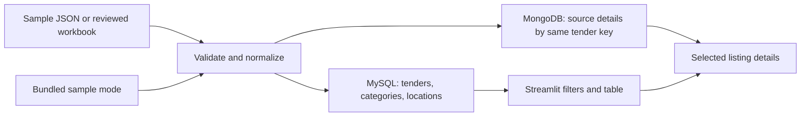
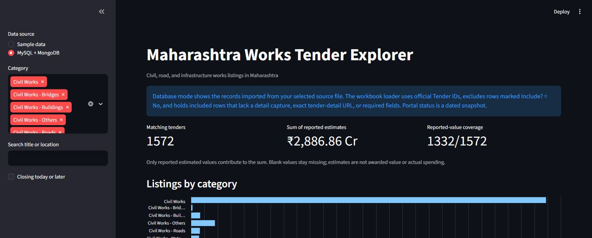
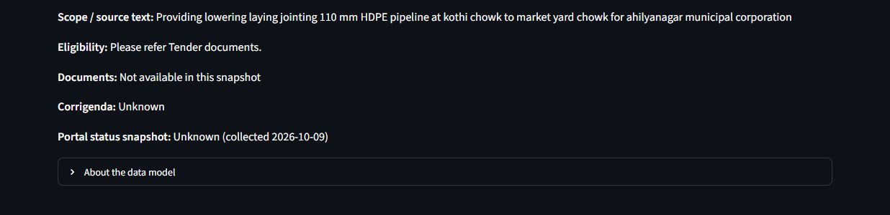

# Maharashtra Works Tender Explorer

This is the working DCDS mini-project: a small dashboard for browsing Maharashtra civil, road and infrastructure tender listings. It is built with Python and Streamlit. MySQL holds fields that are useful for filtering and joins; MongoDB holds the source-specific details for the same record.

This repository contains the code and evidence available so far. It is not a complete archive of Maharashtra tenders, and a listed estimate is not an award amount or actual spending. For a plain-language team briefing, see the [Team Project Audit Book](docs/TEAM_PROJECT_AUDIT.md).

For the current team status, evidence and hand-in checklist, see the [Team Project Audit Book](docs/TEAM_PROJECT_AUDIT.md) and [numbered project plan](docs/PROJECT_PLAN.md).

## What works in the code

- Browse a bundled snapshot of 129 Tender247 category listings without running either database.
- Compare category counts on a horizontal chart whose count axis starts at zero.
- Filter by category and source-reported location; search by title, location, or source ID; and optionally hide listings whose closing date has passed.
- Compare reported estimates, see how many matching rows have an estimate, and refresh cached database data on demand.
- Inspect the stored source text and open a trusted source page through a link with query parameters and fragments removed. The full captured URL is not shown in the dashboard.
- Prepare a MySQL and MongoDB import from the sample JSON or a reviewed MahaTenders workbook.
- Keep the original source ID in `source_record_id`; use `mahatenders:<Tender ID>` or `tender247:<listing-id>` as the shared database key.

The dashboard opens in MySQL + MongoDB mode when the local setup is available; Sample mode remains the offline fallback. On 12 October, both database connections were restored, the full accepted set of 1,572 records was re-imported, and the source-to-database reconciliation passed. The SQL examples, MongoDB operations and database-mode dashboard query path have been demonstrated.

The imported official dataset is still focused on Works notices: 1,572 records are accepted, two remain held for missing detail-page evidence, and 45 third-party records remain excluded. A further 127 official Works detail pages have been captured for review but are not mapped or loaded. The search for additional official categories is queued at the portal's visible CAPTCHA step; no results have been captured for that search. See the [scraping audit](docs/WEB_SCRAPING_AUDIT.md) and [work log](docs/WORK_LOG.md) for dates, evidence boundaries and next actions.

The editable [project report](reports/Maharashtra_Works_Tender_Explorer_Report_2026-10-12.docx) is a review draft, not the final submission. It records the remaining instructor and team confirmations. The [numbered plan](docs/PROJECT_PLAN.md) tracks those tasks.

## Run the sample dashboard

Use Python 3.10 or newer. From the repository folder:

```powershell
git clone https://github.com/Shorya-Raj/DCDS-Project.git
cd DCDS-Project
py -3 -m venv .venv
.\.venv\Scripts\Activate.ps1
python -m pip install --upgrade pip
pip install -r requirements.txt
python -m streamlit run app.py
```

Choose **Sample data** in the sidebar. No `.env` file or database is needed for this mode.

The normalization tests can be run with `python -m unittest discover -s tests -v`. All 7 tests passed on 12 October after the normalization and database changes.

## Run with MySQL and MongoDB

1. Copy `.env.example` to `.env` and replace the local MySQL passwords. Git ignores `.env`.
2. If the portable server files are missing and both database data folders are empty, install them once with `powershell -ExecutionPolicy Bypass -File scripts/install_local_databases.ps1`. This downloads MySQL 8.4.9 and MongoDB 7.0.28 from their official vendor download hosts and creates a loopback-only local setup under `%LOCALAPPDATA%\DCDS`. The installer refuses to initialize non-empty data folders. Start both databases with `powershell -File scripts/start_local_databases.ps1`; run that command again after a reboot. `powershell -File scripts/start_local_databases.ps1 -Action Status` checks their local listeners. On a computer with Docker Desktop, `docker compose up -d` is an alternative.
3. Import a small batch first, then point the loader to your reviewed workbook. The commands below use the separate Tender247 sample dataset:

```powershell
python -m tender_explorer.load_data --input data/sample_tenders.json --dry-run
python -m tender_explorer.load_data --input data/sample_tenders.json --sample-size 25
python -m tender_explorer.check_data
```

Repeat the sample import and consistency check once to confirm that the IDs still match. For the reviewed workbook, pass its path to `--input`; after import, use `python -m tender_explorer.check_data --expected-input <path-to-reviewed-workbook.xlsx>` to compare both databases with the accepted source plan. Keep the workbook outside Git: official portal URLs can contain session-specific query values.

The portable servers are user-run processes, not Windows services. Their binaries, data, configuration and logs are under `%LOCALAPPDATA%\DCDS`, outside this OneDrive project folder. On 12 October, the previous configured local root was found absent despite the earlier successful setup in the project log. The server files and fresh data directories were restored, then all 1,572 accepted rows were loaded and reconciled against the reviewed workbook. The ignored project `.env` supplies local credentials; never share it or commit it.

The workbook loader keeps each official Tender ID as `source_record_id` and builds a `mahatenders:<Tender ID>` database key. It skips `Include? = No` rows and holds included rows without a captured detail page, exact official detail URL, or required fields. A dry run plans the mapping but never connects to a database. The 12 October recheck reported 1,572 rows ready, 2 included rows held, and 45 excluded rows; the accepted set is loaded in both databases and reconciled against the same workbook snapshot.

For the Docker setup, `docker compose down` stops its services. `docker compose down -v` also deletes the Docker database volumes. These Docker commands do not control the portable local servers.

## How the pieces fit together



The 25-record official workbook pilot was imported twice and reconciled after each pass. The accepted 1,572-record set was then loaded into both databases, and the final checker confirmed matching keys and shared fields against the workbook plan. The database-mode dashboard was also opened and showed MongoDB detail for a selected MySQL listing. See [Architecture](docs/ARCHITECTURE.md) for the schema and [Project plan](docs/PROJECT_PLAN.md) for the remaining checkpoints.

## Data and limits

`data/sample_tenders.json` has 129 third-party Tender247 listings. Its URLs point to category pages, not official tender-detail notices. It does not provide verified eligibility, corrigenda, bid, award or actual-spending records. Sample records use `tender247:<listing-id>` keys; official records use `mahatenders:<Tender ID>` keys while retaining the original Tender ID in `source_record_id`.

The collection history, duplicate-review rules, record counts and known gaps are in the [data-collection audit](docs/WEB_SCRAPING_AUDIT.md). The [work log](docs/WORK_LOG.md) records implementation and environment checks. Raw workbooks and capture files stay outside this repository because they can contain session-bearing links; their absence means the report cannot be independently rebuilt from a fresh clone alone.

## Course-project evidence map

| DCDS area | Where to look |
|---|---|
| Python and data cleaning | `tender_explorer/normalize.py`, `load_data.py` |
| Relational model and SQL queries | `sql/schema.sql`, `sql/queries.sql` |
| MongoDB document operations | `tender_explorer/mongo_queries.py` |
| User interface and data retrieval | `app.py`, `tender_explorer/database.py` |
| Import consistency check | `tender_explorer/check_data.py` |
| Source handling and project checkpoints | `docs/DATA_SOURCES.md`, `docs/PROJECT_PLAN.md` |

Saved database-demo evidence is under [`docs/evidence/`](docs/evidence/): two dashboard screenshots and sanitized SQL/MongoDB outputs in Markdown and HTML. These dashboard images show the verified 12 October database run before the final interface refinement; refreshed screenshots and a query-output screenshot are still needed before submission.



*Database view from the 12 October verification run. The final interface refinement came later, so this is evidence of the database flow rather than the final presentation layout.*



*The selected record's source-specific details came from MongoDB using the same tender key as its MySQL listing.*

## Repository map

```text
app.py                   Streamlit dashboard
tender_explorer/         Validation, import, database access, MongoDB examples
sql/                     MySQL schema and example queries
data/sample_tenders.json Small sample for offline presentation mode
tests/                   Existing normalization tests
docs/                    Architecture, data notes, audit and work log
docs/evidence/           Sanitized dashboard and database-demo evidence
reports/                 Editable report draft; render scratch files are ignored
```

For the next change, use a short branch and open a pull request. See [Contributing](CONTRIBUTING.md). The plan is a working checklist, not a promise of marks; the team should compare it with the instructor's current rubric before submission.
