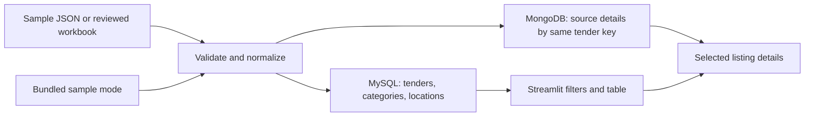

# Maharashtra Works Tender Explorer

This is the working DCDS mini-project: a small dashboard for browsing Maharashtra civil, road and infrastructure tender listings. It is built with Python and Streamlit. MySQL holds fields that are useful for filtering and joins; MongoDB holds the source-specific details for the same record.

This repository contains the code and evidence available so far. It is not a complete archive of Maharashtra tenders, and a listed estimate is not an award amount or actual spending.

## What works in the code

- Browse a bundled snapshot of 129 Tender247 category listings without running either database.
- Filter by category, search title or location, and optionally hide listings whose closing date has passed.
- Compare reported estimates and see how many matching rows have an estimate.
- Inspect the stored source text and source URL for one listing.
- Prepare a MySQL and MongoDB import from the sample JSON or a reviewed MahaTenders workbook.
- Keep official Tender IDs and Tender247 listing IDs distinct, and leave unavailable details blank.

Sample mode is the available fallback for a presentation. Database mode needs local MySQL and MongoDB services and a successful import. The 11 October work log records a workbook dry run, but no database import has been verified yet.

## Run the sample dashboard

Use Python 3.10 or newer. From the repository folder:

```powershell
git clone https://github.com/Shorya-Raj/DCDS-Project.git
cd DCDS-Project
py -3 -m venv .venv
.\.venv\Scripts\Activate.ps1
python -m pip install --upgrade pip
pip install -r requirements.txt
python -m streamlit run app.py
```

Choose **Sample data** in the sidebar. No `.env` file or database is needed for this mode.

The existing normalization tests can be run with `python -m unittest discover -s tests -v`. The 11 October work log records seven passing tests; they were not rerun during repository setup.

## Run with MySQL and MongoDB

1. Copy `.env.example` to `.env` and replace the local MySQL passwords.
2. Start Docker Desktop, then run `docker compose up -d`.
3. Import the 129-record sample first, or point the loader to your reviewed workbook:

```powershell
python -m tender_explorer.load_data --input data/sample_tenders.json --dry-run
python -m tender_explorer.load_data --input data/sample_tenders.json --sample-size 25
python -m tender_explorer.check_data
```

Repeat the sample import and consistency check once to confirm that the IDs still match. After that, use the full reviewed workbook import only when you are ready. Keep the workbook outside Git: official portal URLs can contain session-specific query values.

The workbook loader maps rows by official Tender ID. It skips `Include? = No` rows and holds included rows without a captured detail page, exact official detail URL, or required fields. A dry run plans the mapping but never connects to a database. The 11 October snapshot plan reported 1,572 rows ready, 2 included rows held, and 45 excluded third-party rows; this is historical mapping evidence, not proof that those rows are in a database today.

To stop local services, run `docker compose down`. To remove the local database volumes too, run `docker compose down -v`; this deletes the local databases.

## How the pieces fit together



The diagram describes the intended data path. The workbook dry run is recorded, but the MySQL/MongoDB import path still needs a live end-to-end check. See [Architecture](docs/ARCHITECTURE.md) for the schema and [Project plan](docs/PROJECT_PLAN.md) for the next checkpoints.

## Data and limits

`data/sample_tenders.json` has 129 third-party Tender247 listings. Its URLs point to category pages, not official tender-detail notices. It does not provide verified eligibility, corrigenda, bid, award or actual-spending records. Sample records use `tender247:<listing-id>` keys; official records use the MahaTenders Tender ID.

The collection history, duplicate-review rules, record counts and known gaps are in the [data-collection audit](docs/WEB_SCRAPING_AUDIT.md). The [work log](docs/WORK_LOG.md) records implementation and environment checks. Raw workbooks and capture files stay outside this repository because they can contain session-bearing links; their absence means the report cannot be independently rebuilt from a fresh clone alone.

## Course-project evidence map

| DCDS area | Where to look |
|---|---|
| Python and data cleaning | `tender_explorer/normalize.py`, `load_data.py` |
| Relational model and SQL queries | `sql/schema.sql`, `sql/queries.sql` |
| MongoDB document operations | `tender_explorer/mongo_queries.py` |
| User interface and data retrieval | `app.py`, `tender_explorer/database.py` |
| Import consistency check | `tender_explorer/check_data.py` |
| Source handling and project checkpoints | `docs/DATA_SOURCES.md`, `docs/PROJECT_PLAN.md` |

## Repository map

```text
app.py                   Streamlit dashboard
tender_explorer/         Validation, import, database access, MongoDB examples
sql/                     MySQL schema and example queries
data/sample_tenders.json Small sample for offline presentation mode
tests/                   Existing normalization tests
docs/                    Architecture, data notes, audit and work log
```

For the next change, use a short branch and open a pull request. See [Contributing](CONTRIBUTING.md). The plan is a working checklist, not a promise of marks; the team should compare it with the instructor's current rubric before submission.
