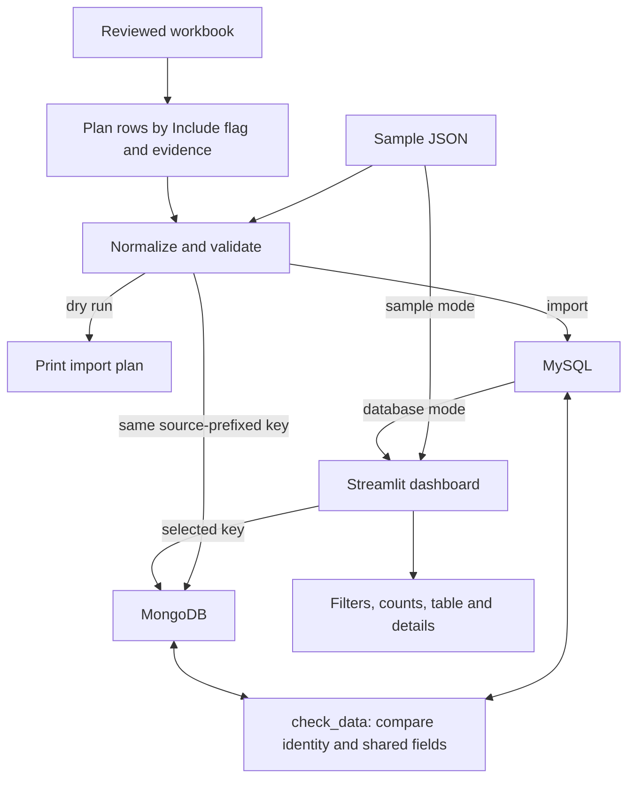
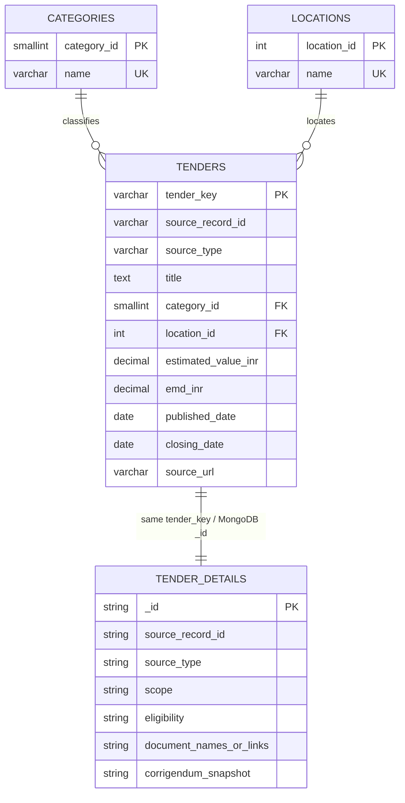

# Architecture and database design

## Data path

The dashboard has an offline sample mode and a database mode. Sample mode reads the bundled JSON. Database mode reads filterable fields from MySQL, then uses the selected record's shared key to retrieve its MongoDB document.

Imports use upserts, so repeating an accepted record updates that record instead of creating another. The checker compares each database's key set, checks that every key is derived from its source type and original source ID, and compares shared values against each other and, when requested, the source import plan. The 1,572-record import and database-mode dashboard check were completed on 12 October; see the work log for evidence.

## Record identity

Each record has two identity fields:

| Field | Example | Purpose |
|---|---|---|
| `source_record_id` | `2026_NMC_1342575_23` or `12345` | The ID as supplied by the originating source |
| `tender_key` | `mahatenders:2026_NMC_1342575_23` or `tender247:12345` | The shared primary key in MySQL and `_id` in MongoDB |

The source prefix prevents two different websites from accidentally assigning the same ID. MySQL also enforces uniqueness on (`source_type`, `source_record_id`); MongoDB uses a unique index on the same pair. The key convention is created by `make_tender_key()` and checked by `check_data.py`.

## Relational model

`TENDER_DETAILS` is MongoDB's collection, not a fourth MySQL table. The shared key expresses a one-to-one relationship across the two separate databases; MySQL cannot enforce a foreign key into MongoDB, so the import checker verifies the match. MySQL's category and location lookup tables are enforced with foreign keys.

## What belongs in each database

- **MySQL** holds the fields used in filters, sorting, joins, and summaries: source identity, title, category, location, published/closing dates, estimated value, EMD, and source URL. Category and location names are normalized into lookup tables. Money uses `DECIMAL(18,2)`.
- **MongoDB** holds a document for the same listing. It repeats the common fields needed to explain and verify a record, then keeps flexible source fields such as department, work description, eligibility, document references, status snapshot, and raw workbook row when available. Money uses BSON `Decimal128` to preserve decimal precision.
- **Missing information stays missing.** Estimated value, EMD, published date, and source-specific details may be null or absent when the source did not supply them. A missing estimate is not treated as zero.

Category and location lookup names follow MySQL's case-insensitive uniqueness rules. MongoDB keeps the spelling found in the source document. The cross-store checker compares those two labels without regard to capitalization; the source spelling remains available in the MongoDB record and its raw workbook row.

The MongoDB collection has a JSON Schema validator for its required shared fields and field types. Its rule allows the variable detail fields to differ between sources. The current project rules require a source ID, source type, title, category, location, closing date, and source URL. The official workbook mapper also requires an organisation, publication date, closing date, and exact captured official detail URL before accepting a row.

## Schema and migration boundary

The importer creates missing tables, collection validation rules, and indexes. It does not silently transform an older MySQL `tenders` table: if required columns are missing, it stops before importing and asks for an explicit backup and migration. The current schema and collection validation were applied during the local pilot/import; the full 1,572-record set now reconciles across the source plan and both databases.

## Code map

| File | Responsibility |
|---|---|
| `app.py` | Streamlit mode selection, category/location filters, title/location/source-ID search, summary, table, privacy-filtered source link and detail panel |
| `tender_explorer/normalize.py` | Validate sample records, map workbook rows, create shared keys and MongoDB documents |
| `tender_explorer/load_data.py` | Dry run, deterministic sample selection and database import |
| `tender_explorer/database.py` | MySQL/MongoDB connections, schema setup, constraints, upserts and reads |
| `tender_explorer/check_data.py` | Compare key sets, verify source-derived keys and compare shared field values against each other and optionally the source import plan |
| `tender_explorer/mongo_queries.py` | MongoDB CRUD and aggregation examples |
| `sql/schema.sql` | Relational tables, constraints and indexes |
| `sql/queries.sql` | Join/grouping, subquery and `HAVING` examples |

## Data limits that affect design

The bundled Tender247 URLs identify category listings, not individual official notices. Their documents therefore leave eligibility, documents, and corrigenda unavailable. The official workbook mapping requires an exact official detail URL and required fields before a row is ready. Estimated tender value and EMD are different measures; neither is awarded value or actual spending.
