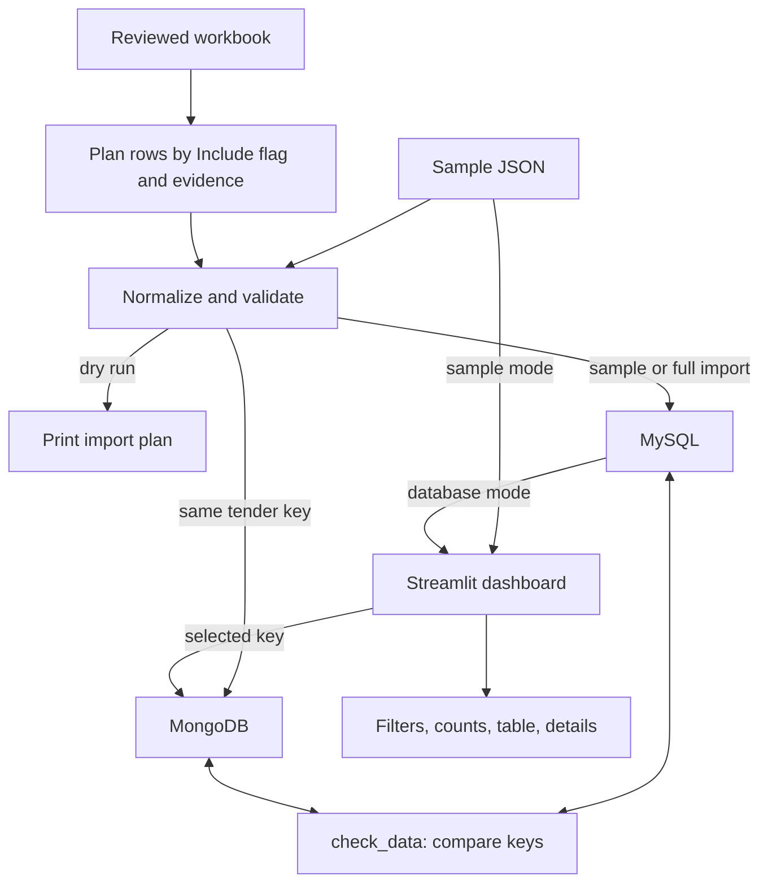
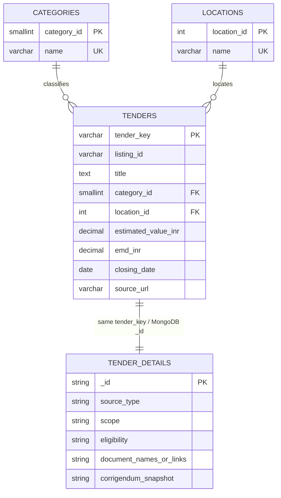

# Architecture and database design

## Data path

The app has two ways to get rows. Sample mode reads the checked-in JSON file and stays offline. Database mode reads structured fields from MySQL and looks up the selected record's document in MongoDB using the same key.

The import code uses upserts so rerunning a record with the same key updates that record instead of creating a second one. The work log records the workbook dry run and a historical sample-mode browser check. A live database import, repeat pass and cross-store check have not been confirmed.

## Relational model

`TENDER_DETAILS` is a MongoDB document collection, not a fourth MySQL table. The line means each SQL tender key is intended to match one document `_id`; `check_data.py` compares the key sets. Some detail values can be absent, and the code preserves that absence.

## Why two stores are used here

- MySQL stores the shared fields used for filtering and grouping. Category and location names are separated into lookup tables and referenced by foreign keys.
- MongoDB stores a document with optional, source-shaped fields such as scope, eligibility, source notes and document references.
- Both stores use a stable tender key. For official records this is the MahaTenders Tender ID. For the bundled Tender247 snapshot it is namespaced as `tender247:<listing-id>` so it cannot be mistaken for an official Tender ID.

The project uses both stores to demonstrate relational queries and document retrieval. This is a course-project design choice, not a claim that one database cannot represent the other's data.

## Code map

| File | Responsibility |
|---|---|
| `app.py` | Streamlit mode selection, filters, summary, table and detail panel |
| `tender_explorer/normalize.py` | Validate sample records and map reviewed workbook rows |
| `tender_explorer/load_data.py` | Dry run, deterministic sample selection and database import |
| `tender_explorer/database.py` | MySQL/MongoDB connections, schema setup, upserts and reads |
| `tender_explorer/check_data.py` | Compare IDs in the two stores |
| `tender_explorer/mongo_queries.py` | MongoDB CRUD and aggregation examples |
| `sql/schema.sql` | Relational tables, constraints and indexes |
| `sql/queries.sql` | Join/grouping, subquery and `HAVING` examples |

## Data limits that affect design

The bundled Tender247 URLs identify category listings, not individual official notices. Its MongoDB details therefore leave eligibility, documents and corrigenda empty. The official workbook mapping requires an exact official detail URL and required fields before a row is ready. Estimated tender value and EMD are separate measures; neither is actual spending.
