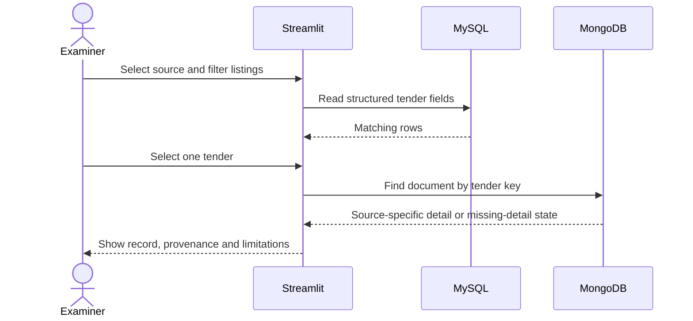

# Project plan and assessment checklist

This is the team's working plan for finishing and presenting the DCDS mini-project. Status below comes from the files and work log currently available in this repository. It is not a claim that a mark, registration or instructor approval has been confirmed.

## Canonical work sequence

Use these numbers in project status updates and team discussions. This is the original ordered work list from the Clarify task chat; the assessment topics below are a separate rubric checklist.

| Step | Work | Status on 12 October 2026 | Evidence / next action |
|---:|---|---|---|
| 1 | Check setup and choose how to run the databases. | **Complete; local services restored.** | The earlier 12 October audit records a successful portable setup, but the configured `%LOCALAPPDATA%\DCDS` root and both server processes were absent during the latest check. Reinstalled the project-pinned MySQL 8.4.9 and MongoDB 7.0.28 ZIP servers in a new local data root. Both bind to `127.0.0.1`; `scripts/start_local_databases.ps1` starts them after reboot. |
| 2 | Confirm the database design and record identity. | **Complete and applied through the pilot import.** | MySQL, MongoDB, importer, dashboard and checker use the same source-prefixed `tender_key`, retain `source_record_id`, and define required/shared fields. The pilot created the current schema and collection validation. See `ARCHITECTURE.md` and the 12 October work-log entry. |
| 3 | Prepare and check the import source. | **Complete for the current reviewed workbook snapshot; new captures await mapping.** | Fresh offline dry runs report 1,572 ready, rows 9–10 held, 45 excluded, and a deterministic 25-record sample. A separate 127-page capture set is not yet mapped, reviewed or loaded. No database connection was opened during the dry run. Refresh if the workbook or mapped capture set changes. |
| 4 | Load and reconcile the 25-record pilot. | **Complete.** | Imported the deterministic 25 records twice. `check_data.py` passed after each import; both stores contain the same 25 records. The exact IDs are in `IMPORT_PILOT_IDS_2026-10-12.csv`. |
| 5 | Load accepted workbook rows. | **Complete and reconciled again.** | Re-imported 1,572 workbook-ready records into both fresh local databases; the checker confirmed 1,572 MySQL rows, 1,572 MongoDB documents and 1,572 source-plan records with matching keys and shared fields. Two rows remain held and 45 `Include? = No` rows remain excluded. |
| 6 | Demonstrate SQL/MongoDB database work. | **Complete.** | All three SQL examples ran on the 1,572 records. MongoDB read and aggregation ran on project data; create/read/update/delete ran on a temporary document that was removed. 240 accepted records retain a missing estimate as NULL. The location query counts source-reported labels; review them before treating every label as a standardized district. |
| 7 | Connect and check the dashboard in database mode. | **Database path verified; app opened.** | The dashboard's MySQL listing query returned 1,572 rows; its MongoDB detail lookup found the matching document for the same tender key. Streamlit health returned HTTP 200. Database mode is now the default, with Sample data still available. Saved dashboard screenshots show the verified data but predate the final 12 October interface refinement; refresh them before hand-in. |
| 8 | Finish hand-in and demo materials. | **In progress; Steps 1–7 are complete. Report draft prepared on 12 October.** | The app/database checks passed and dashboard screenshots plus sanitized SQL/MongoDB outputs are saved under `docs/evidence/`. The editable report is a review draft; all six rendered pages were visually reviewed on 12 October, with no clipping or overlap found. SQL/MongoDB output screenshots, refreshed dashboard screenshots, demo rehearsal, contribution record, and team/instructor confirmation of title, rubric/date and submission format remain. |

Do not depend on scraping a live portal during the examiner demonstration. Keep the current source snapshot and provenance limits visible in the explanation.

## Other coordination items

- Confirm the registered title and team/registration state, and ask whether the saved rubric is current. Its ESE date is explicitly tentative (26–30 October 2026), and it does not specify a report template or submission format. Confirm the final schedule, format, and named owners with the team/instructor ([GitHub issue #2](https://github.com/Shorya-Raj/DCDS-Project/issues/2)).
- Map and review the 127 newly captured official Works pages before any import ([issue #8](https://github.com/Shorya-Raj/DCDS-Project/issues/8)). Reconcile the historical 129-link manifest, review held rows, and resolve the title/location conflict for record #1356 from its official notice document ([issue #4](https://github.com/Shorya-Raj/DCDS-Project/issues/4)).
- Broaden the official dataset beyond Works only after the user completes the visible MahaTenders CAPTCHA and clicks Search. The 12 October Electrical Goods/Equipment search plan has no captured results yet; do not treat this as completed diversification ([issue #9](https://github.com/Shorya-Raj/DCDS-Project/issues/9)).
- Finalize the report, refresh evidence after the interface refinement, capture query outputs, and rehearse both demo modes ([issue #5](https://github.com/Shorya-Raj/DCDS-Project/issues/5)).
- The repository uses a short branch and pull-request process; see `CONTRIBUTING.md`.

## Map the available rubric topics to project evidence

The saved four-page DCDS Lab ESE rubric was checked locally on 12 October; the course PDF is not included in this repository. It lists the miniproject as a 10-mark component worth 40%, covering CO1–CO5, with a tentative ESE date of 26–30 October 2026. Confirm with the instructor that this copy and date are still current. The scoring criteria are:

| Rubric criterion | Maximum | Evidence to prepare |
|---|---:|---|
| Application design and functionality | 2 marks | Explain the user flow and show search/filtering, summary values, table, and detail panel. |
| Python programming implementation | 2 marks | Walk through normalization, import planning, database access, modular code, and Streamlit behavior. |
| Database integration (SQL and NoSQL) | 2 marks | Show the shared tender key, MySQL listing, matching MongoDB details, and reconciliation. |
| Advanced database querying and retrieval | 2 marks | Run and explain joins, nested/subqueries, grouping, and MongoDB aggregation. |
| Code quality, documentation, output presentation and UI | 1 mark | Prepare readable code/docs and clear, meaningful interface output. |
| Testing, validation, security and error handling | 1 mark | Show import-plan validation, reconciliation, missing/held records, local-only ports, ignored `.env`, and error handling. The repeat-import check is complete; the current suite was rerun on 12 October and all 7 unit tests passed. |

## Demo outline

If a database service is unavailable during assessment, switch to sample mode and state which parts of the SQL/MongoDB path are being demonstrated separately. Never present sample-mode rows as official detail-page captures.

## Team work split

Add actual names only after the team agrees. Each member should be able to explain the whole flow, not only their assigned file.

| Area | Team member | Evidence produced |
|---|---|---|
| Data provenance and source review | To assign | Current source manifest, inclusion rules, unresolved-row notes |
| SQL design and queries | To assign | ER diagram, schema explanation, query outputs |
| MongoDB model and integration | To assign | Example document, CRUD/aggregation demonstration, ID reconciliation |
| Python app, demo and report | To assign | Rehearsed user flow, slides/report, contribution summary |
