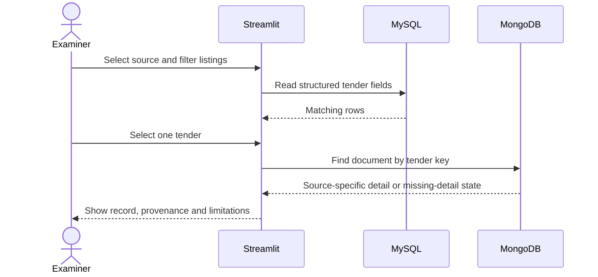

# Project plan and assessment checklist

This is the team's working plan for finishing and presenting the DCDS mini-project. Status below comes from the files and work log currently available in this repository. It is not a claim that a mark, registration or instructor approval has been confirmed.

## Current checkpoint

| Area | Status | Evidence or remaining check |
|---|---|---|
| Offline dashboard | Implemented; sample-mode browser check recorded on 11 October | `app.py`, `data/sample_tenders.json`, `docs/WORK_LOG.md` |
| MySQL schema and query examples | In the repository | `sql/schema.sql`, `sql/queries.sql`; run against the chosen MySQL version before the demo |
| MongoDB document operations | In the repository | `tender_explorer/mongo_queries.py`; demonstrate CRUD and aggregation on actual project documents |
| Official workbook mapping | Dry run recorded: 1,572 ready, 2 held, 45 excluded | No MySQL/MongoDB import has been verified; refresh counts if the workbook changes |
| Database mode | Not verified | Docker and local database ports were unavailable in the 11 October environment check |
| Source follow-up | Open | Reconcile the older 129-link manifest, the held rows and the title/location discrepancy described in the audit |
| Course submission details | Needs team/instructor confirmation | Confirm current registered title, team/registration state, schedule and complete rubric |
| GitHub workflow | Repository uses a short branch and pull-request process | See `CONTRIBUTING.md` for future project changes |

## Action plan

| Order | Action | Owner | Done when |
|---:|---|---|---|
| 1 | Check the final registered project title, current submission requirements and exact evaluation rubric with the team/instructor. Assign a named owner for each area. | Team | The team has one agreed scope, a current rubric copy and named responsibilities. |
| 2 | Prepare a working Python environment and local MySQL 8/MongoDB 7 services. Keep credentials in the ignored `.env` file. | Setup owner | Sample mode runs, both databases accept a local connection, and database mode can read an imported record. |
| 3 | Use the reviewed workbook's dry-run plan, then import a deterministic 25-record sample twice. Run the key consistency check after each pass. | Data/database owners | Both stores contain the same expected sample IDs after both runs; held and excluded rows remain accounted for. |
| 4 | Review every hold and unresolved source issue before deciding what can enter a full import. Refresh the audit against the current workbook. | Data owner | The latest workbook counts, evidence gaps and duplicate decisions are recorded; no unresolved row is silently promoted. |
| 5 | Load the accepted set only after the sample passes. Save the import output and reconciliation summary without committing raw session-bearing URLs. | Data/database owners | The final accepted count matches in MySQL and MongoDB and can be explained from the saved import plan. |
| 6 | Rehearse one short examiner-led path in sample mode and one database-backed path if services are available. Keep sample mode as the offline fallback. | Demo owner | A clean run shows filtering, one SQL-backed listing, its matching MongoDB detail, a meaningful query and the source limits. |
| 7 | Assemble the submission evidence: problem statement, architecture/ER diagram, schema, selected queries, source notes, screenshots or logs, limitations and contribution split. | Whole team | Each rubric area has a concrete artifact or live demonstration and every claim is backed by evidence. |

The order is deliberate: settle the course requirements and environment, prove a small database load, then decide whether a full load is safe. Do not make the examiner demo depend on scraping a live portal.

## Map the available rubric topics to project evidence

The prior project-context review records evaluation areas around application design/functionality, Python, SQL and NoSQL integration, advanced queries/data retrieval, code quality/UI, testing, security and error handling. The complete current rubric has not been verified here, so use this as a preparation map and compare it with the official copy.

| Evaluation topic | Evidence to prepare |
|---|---|
| Application design and functionality | Explain the user flow and show category/search/date filters, summary values, table and detail panel. |
| Python implementation | Walk through normalization, import planning, database access and Streamlit code. |
| SQL | Explain keys, foreign keys, lookup tables and indexes; run the join/grouping, subquery and `HAVING` examples. |
| NoSQL | Explain a source-shaped document keyed by the same tender ID; demonstrate `find_one`, upsert/update/delete and category aggregation. |
| Integration and retrieval | Show a selected SQL listing and its MongoDB document; run `check_data.py` and explain what a mismatch means. |
| Code quality and interface | Keep setup reproducible, explain module boundaries, show clear data-source labels and meaningful empty/error states. |
| Testing | Prepare existing normalization test results plus the 25-record repeat-import and reconciliation evidence. Do not describe the latter as done until it is run. |
| Security and error handling | Show local-only database ports, ignored `.env`, no session URLs in Git, validation/held-row behavior and database error messages. |

## Demo outline

If a database service is unavailable during assessment, switch to sample mode and state which parts of the SQL/MongoDB path are being demonstrated separately. Never present sample-mode rows as official detail-page captures.

## Team work split

Add actual names only after the team agrees. Each member should be able to explain the whole flow, not only their assigned file.

| Area | Team member | Evidence produced |
|---|---|---|
| Data provenance and source review | To assign | Current source manifest, inclusion rules, unresolved-row notes |
| SQL design and queries | To assign | ER diagram, schema explanation, query outputs |
| MongoDB model and integration | To assign | Example document, CRUD/aggregation demonstration, ID reconciliation |
| Python app, demo and report | To assign | Rehearsed user flow, slides/report, contribution summary |
